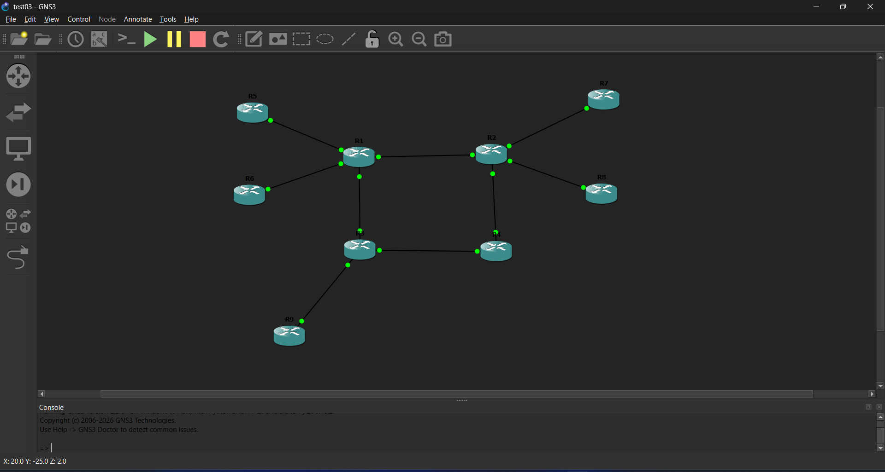
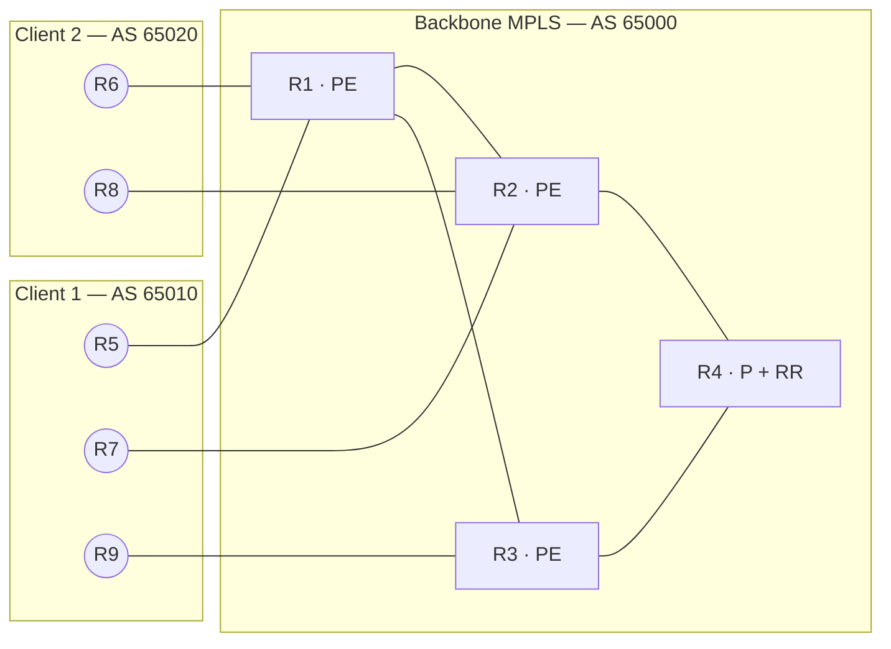
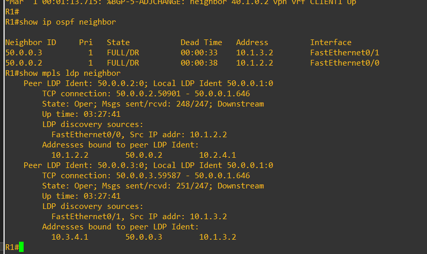
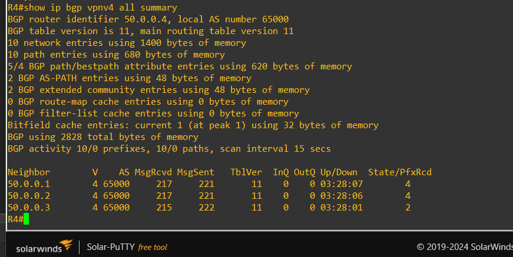
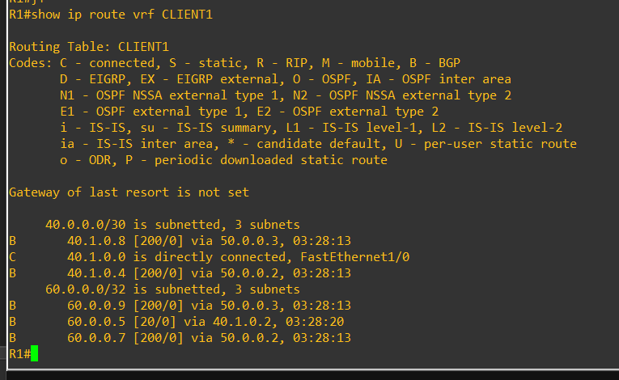
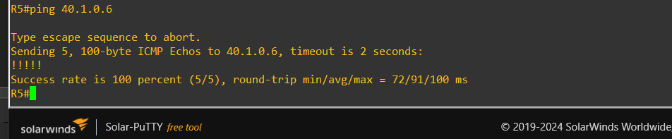
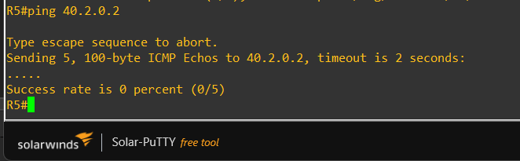

# MPLS L3VPN sous GNS3

Simulation d'un réseau opérateur **MPLS** offrant un service **VPN de niveau 3 (L3VPN / BGP-MPLS VPN, RFC 4364)** à deux clients isolés, réalisée sous **GNS3** avec des routeurs Cisco IOS.

Le backbone de l'opérateur (AS 65000) transporte le trafic de deux clients sur la même infrastructure. Le **client 1** a trois sites et le **client 2** en a deux. Les **VRF** séparent les tables de routage des deux clients, si bien qu'aucun ne peut joindre l'autre.

---

## Sommaire

- [Topologie](#topologie)
- [Technologies utilisées](#technologies-utilisées)
- [Rôle des routeurs](#rôle-des-routeurs)
- [Plan d'adressage](#plan-dadressage)
- [Architecture logique](#architecture-logique)
- [Configurations](#configurations)
- [Vérifications et tests](#vérifications-et-tests)
- [Points clés](#points-clés)
- [Structure du dépôt](#structure-du-dépôt)

---

## Topologie





---

## Technologies utilisées

| Couche | Protocole | Rôle |
|---|---|---|
| IGP du cœur | **OSPF** (area 0) | Joignabilité des liens et loopbacks du backbone |
| Commutation | **MPLS / LDP** | Distribution des labels de transport entre P/PE |
| Plan de contrôle VPN | **MP-BGP VPNv4** (iBGP) | Échange des routes clients entre PE avec RD/RT |
| Passage à l'échelle | **Route Reflector** (R4) | Évite le full-mesh iBGP entre les PE |
| Isolation | **VRF** | Table de routage dédiée par client sur chaque PE |
| PE ↔ CE | **eBGP** | Échange des routes entre le site client et l'opérateur |

---

## Rôle des routeurs

| Routeur | Rôle | Connecté à |
|---|---|---|
| R1 | **PE** (2 VRF) | R2, R3 (cœur), R5 (client 1), R6 (client 2) |
| R2 | **PE** (2 VRF) | R1, R4 (cœur), R7 (client 1), R8 (client 2) |
| R3 | **PE** (1 VRF) | R1, R4 (cœur), R9 (client 1) |
| R4 | **P** + **Route Reflector** | R2, R3 (cœur uniquement) |
| R5, R7, R9 | **CE**, client 1 | un lien vers leur PE |
| R6, R8 | **CE**, client 2 | un lien vers leur PE |

**Pourquoi R4 est Route Reflector :** c'est le seul routeur du cœur qui n'a ni VRF ni client. La partie VPN reste sur les PE, et le contrôle BGP est centralisé sur le routeur P.

**Pourquoi R1 et R2 ont deux VRF :** chacun dessert un site du client 1 et un site du client 2. Il leur faut donc une table de routage par client, avec des RD/RT différents.

---

## Plan d'adressage

### Backbone opérateur (AS 65000)

| Lien | Réseau | Extrémité A | Extrémité B |
|---|---|---|---|
| R1 – R2 | 10.1.2.0/30 | R1 : 10.1.2.1 | R2 : 10.1.2.2 |
| R1 – R3 | 10.1.3.0/30 | R1 : 10.1.3.1 | R3 : 10.1.3.2 |
| R2 – R4 | 10.2.4.0/30 | R2 : 10.2.4.1 | R4 : 10.2.4.2 |
| R3 – R4 | 10.3.4.0/30 | R3 : 10.3.4.1 | R4 : 10.3.4.2 |

| Routeur | Loopback0 |
|---|---|
| R1 | 50.0.0.1/32 |
| R2 | 50.0.0.2/32 |
| R3 | 50.0.0.3/32 |
| R4 | 50.0.0.4/32 |

### Client 1 (VRF `CLIENT1`, RD/RT `65000:10`, AS 65010)

| Lien | Réseau | IP PE | IP CE | Loopback CE |
|---|---|---|---|---|
| R1 – R5 | 40.1.0.0/30 | 40.1.0.1 | 40.1.0.2 | 60.0.0.5/32 |
| R2 – R7 | 40.1.0.4/30 | 40.1.0.5 | 40.1.0.6 | 60.0.0.7/32 |
| R3 – R9 | 40.1.0.8/30 | 40.1.0.9 | 40.1.0.10 | 60.0.0.9/32 |

### Client 2 (VRF `CLIENT2`, RD/RT `65000:20`, AS 65020)

| Lien | Réseau | IP PE | IP CE | Loopback CE |
|---|---|---|---|---|
| R1 – R6 | 40.2.0.0/30 | 40.2.0.1 | 40.2.0.2 | 70.0.0.6/32 |
| R2 – R8 | 40.2.0.4/30 | 40.2.0.5 | 40.2.0.6 | 70.0.0.8/32 |

> Le dernier octet des loopbacks CE correspond au numéro du routeur (60.0.0.**5** → R5, 70.0.0.**8** → R8).

---

## Architecture logique

1. **OSPF** annonce les loopbacks des routeurs du cœur (R1 à R4).
2. **LDP** associe un label MPLS à chaque loopback, ce qui crée des LSP entre les PE.
3. Chaque **CE** annonce sa loopback à son PE en **eBGP**.
4. Le **PE** place la route dans la VRF du client, lui ajoute le **RD** (unicité) et le **RT** (appartenance au VPN), puis l'envoie en **VPNv4** au Route Reflector R4.
5. **R4** renvoie la route aux autres PE. Chaque PE ne l'importe que dans la VRF dont le RT d'import correspond.
6. Dans le plan de données, chaque paquet client porte **deux labels** : un label de transport (LDP) pour atteindre le PE de sortie, et un label VPN (MP-BGP) pour désigner la bonne VRF.

---

## Configurations

Les configurations complètes sont dans le dossier [`configs/`](configs/) :

| PE / P | CE client 1 | CE client 2 |
|---|---|---|
| [R1](configs/R1.txt) · [R2](configs/R2.txt) · [R3](configs/R3.txt) · [R4](configs/R4.txt) | [R5](configs/R5.txt) · [R7](configs/R7.txt) · [R9](configs/R9.txt) | [R6](configs/R6.txt) · [R8](configs/R8.txt) |

Extrait : la partie BGP d'un PE avec ses deux VRF (R1)

```
router bgp 65000
 neighbor 50.0.0.4 remote-as 65000
 neighbor 50.0.0.4 update-source Loopback0
 address-family vpnv4
  neighbor 50.0.0.4 activate
  neighbor 50.0.0.4 send-community extended
 exit-address-family
 address-family ipv4 vrf CLIENT1
  neighbor 40.1.0.2 remote-as 65010
  neighbor 40.1.0.2 activate
  neighbor 40.1.0.2 as-override
  redistribute connected
 exit-address-family
 address-family ipv4 vrf CLIENT2
  neighbor 40.2.0.2 remote-as 65020
  neighbor 40.2.0.2 activate
  neighbor 40.2.0.2 as-override
  redistribute connected
 exit-address-family
```

---

## Vérifications et tests

### Commandes de vérification

| Commande | Sur | Résultat attendu |
|---|---|---|
| `show ip ospf neighbor` | R1 à R4 | Voisinages OSPF en `FULL` |
| `show mpls ldp neighbor` | R1 à R4 | Sessions LDP `Oper` |
| `show mpls forwarding-table` | R1 à R4 | Labels pour les loopbacks 50.0.0.x |
| `show ip bgp vpnv4 all summary` | R1 à R4 | Sessions VPNv4 établies avec R4 |
| `show ip vrf` | R1, R2, R3 | VRF et interfaces associées |
| `show ip route vrf CLIENT1` | R1, R2, R3 | Routes de R5, R7, R9 |
| `show ip route vrf CLIENT2` | R1, R2 | Routes de R6, R8 |

### Résultats obtenus

#### 1. OSPF et LDP dans le cœur (R1)



R1 est en adjacence OSPF **FULL** avec R2 (50.0.0.2) et R3 (50.0.0.3). Ses deux sessions **LDP** sont à l'état **Oper**, donc la distribution des labels MPLS fonctionne. Les sessions LDP utilisent les loopbacks comme identifiants (`mpls ldp router-id Loopback0 force`).

#### 2. Sessions MP-BGP VPNv4 sur le Route Reflector (R4)



R4 a une session VPNv4 établie avec chacun des trois PE. Le nombre de préfixes reçus correspond à la topologie :

| PE | Préfixes reçus | Détail |
|---|---|---|
| R1 (50.0.0.1) | 4 | CLIENT1 : 60.0.0.5 + lien 40.1.0.0/30 · CLIENT2 : 70.0.0.6 + lien 40.2.0.0/30 |
| R2 (50.0.0.2) | 4 | CLIENT1 : 60.0.0.7 + lien 40.1.0.4/30 · CLIENT2 : 70.0.0.8 + lien 40.2.0.4/30 |
| R3 (50.0.0.3) | 2 | CLIENT1 : 60.0.0.9 + lien 40.1.0.8/30 |

#### 3. Table de routage de la VRF CLIENT1 (R1)



La VRF CLIENT1 de R1 contient les loopbacks des **trois sites du client 1** :
- `60.0.0.5` a une distance de **20** (eBGP) : elle est apprise directement auprès du CE local R5 (40.1.0.2).
- `60.0.0.7` et `60.0.0.9` ont une distance de **200** (iBGP) : elles sont apprises en VPNv4 via R4 et ont pour next-hop les loopbacks des PE distants (50.0.0.2 = R2, 50.0.0.3 = R3).

Cette table ne contient aucune route du client 2 (70.0.0.x), ce qui confirme l'isolation entre les VRF.

#### 4. Ping entre deux sites du même client (R5 → R7)



R5 (site 1 du client 1, derrière R1) joint R7 (site 2 du client 1, derrière R2) sur son adresse 40.1.0.6 avec un taux de **100 %**. Le trafic passe par le backbone MPLS : il entre en VRF CLIENT1 sur R1, est commuté par labels jusqu'à R2, puis remis à R7.

#### 5. Ping entre deux clients différents (R5 → R6) : isolation



R5 (client 1) ne peut pas joindre R6 (client 2, 40.2.0.2) : le taux est de **0 %**. Pourtant, les deux CE sont branchés sur **le même PE (R1)**. Le réseau 40.2.0.0/30 n'existe que dans la VRF CLIENT2, et R1 ne peut le chercher que dans la table de routage CLIENT1. Comme les RT sont différents (65000:10 / 65000:20), aucune route n'est importée d'une VRF à l'autre. **C'est la preuve que les deux VPN sont isolés.**

### Tests de connectivité

| Test | Depuis | Résultat attendu |
|---|---|---|
| `ping 40.1.0.6` | R5 → R7 | ✅ Succès (même client), voir capture 4 |
| `ping 40.2.0.2` | R5 → R6 | ❌ Échec (clients différents), voir capture 5 |
| `ping 60.0.0.7 source 60.0.0.5` | R5 → R7 | ✅ Succès (même client) |
| `ping 60.0.0.9 source 60.0.0.5` | R5 → R9 | ✅ Succès (même client) |
| `ping 70.0.0.8 source 70.0.0.6` | R6 → R8 | ✅ Succès (même client) |
| `ping 70.0.0.6 source 60.0.0.5` | R5 → R6 | ❌ Échec : **preuve de l'isolation VRF** |
| `traceroute 60.0.0.9 source 60.0.0.5` | R5 → R9 | Labels MPLS visibles dans le cœur |

---

## Points clés

- **Deux VRF sur un même PE** : R1 et R2 ont une `address-family ipv4 vrf` par client sous le même `router bgp 65000`. Les voisins d'un client ne sont jamais déclarés dans la VRF de l'autre.
- **R3 n'a qu'une VRF** (CLIENT1) : créer `CLIENT2` sur ce routeur ne servirait à rien.
- **R4 ne connaît aucun client** : il n'a ni VRF ni route client dans sa table IPv4. Il fait la commutation MPLS et réfléchit les routes VPNv4.
- **Isolation par les Route Targets** : CLIENT1 (`65000:10`) et CLIENT2 (`65000:20`) ont des RT différents. Les deux clients pourraient donc utiliser les mêmes adresses privées sans conflit.
- **`as-override`** : les sites du client 1 partagent l'AS 65010, et ceux du client 2 l'AS 65020. Sans cette option, un CE rejetterait les routes de ses autres sites, car il trouverait son propre AS dans l'AS_PATH (protection anti-boucle de BGP). Le PE remplace donc l'AS du client par 65000 lorsqu'il annonce les routes.

---

## Structure du dépôt

```
MPLS-L3VPN-sous-GNS3/
├── README.md
├── configs/            # Configuration de chaque routeur (R1 à R9)
│   ├── R1.txt ... R9.txt
└── captures/           # Captures d'écran GNS3 et résultats des tests
    ├── topologie-gns3.png
    ├── R1-ospf-ldp-neighbors.png
    ├── R4-bgp-vpnv4-summary.png
    ├── R1-route-vrf-client1.png
    ├── ping-R5-vers-R7-succes.png
    └── ping-R5-vers-R6-echec.png
```

---

## Environnement

- **GNS3** avec routeurs **Cisco IOS** (images Dynamips)
- 9 routeurs : 3 PE, 1 P/Route Reflector, 5 CE
